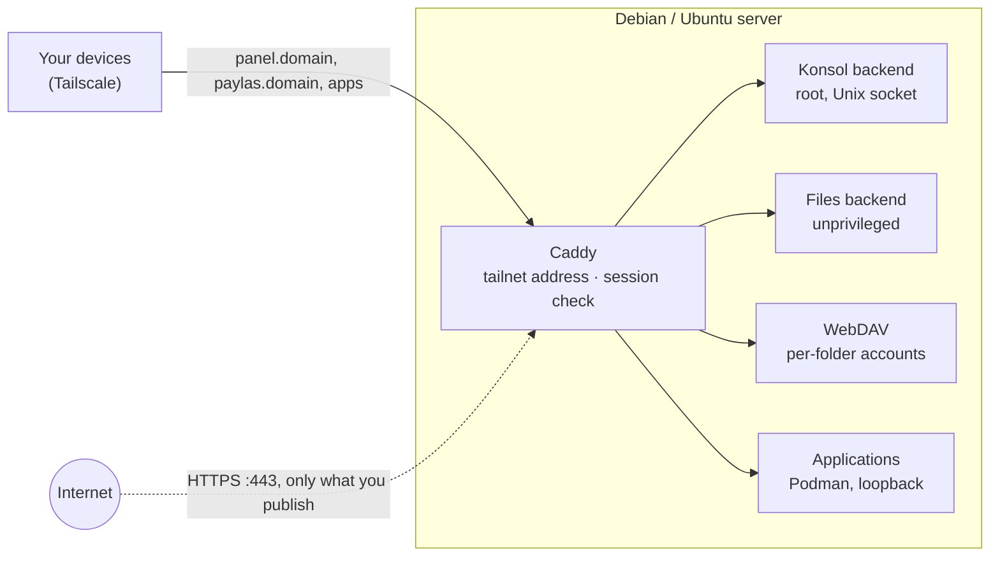

<p align="center"></p>

<p align="center"><strong>A private home server in one command, run from a web console on your tailnet.</strong></p>

<p align="center">
  
  
  
</p>

**Obhut** (German for *safekeeping*) turns a fresh Debian or Ubuntu LTS server into a Tailscale exit
node with local names, a persistent firewall and **Konsol**, a web console for files, shares,
applications and containers. Everything is reachable from your own devices over Tailscale; nothing
is published on the internet unless you choose it. The console and the installer speak Turkish;
the documentation is in English.

## Features

- **One-line install and safe re-runs.** A staged Bash installer, from packages to a final
  verification; running it again is safe. Konsol offers new versions from this repository and
  installs them on confirmation.
- **Private by default.** Konsol and every local name (`panel.<domain>`, `paylas.<domain>`, …) are
  served by Caddy and dnsmasq on the Tailscale address only, behind a firewall that admits listed
  services alone.
- **Files and sharing.** A Finder-style file manager with trash and a text editor (archives are
  Gezgin's); per-folder WebDAV accounts with separate Tailscale and internet switches, read-only
  or read-write access and expiry.
- **Applications.** An App Store of declared packages (WireGuard, qBittorrent, Gezgin) and a Podman page for
  your own containers, with digest-pinned images and explicit port exposure.
- **Optional public names.** Konsol, an application or WebDAV can get an HTTPS name with a
  Let's Encrypt certificate on port 443 — per service, only when you switch it on.
- **Changes you can take back.** A firewall or publication change that could cut you off must be
  confirmed within 60 seconds (a domain change within five minutes), or it rolls back on its own.
  "Check and repair" covers 21 areas.

## How it works



Caddy serves Konsol, WebDAV and published applications. It checks the session for every Konsol
request and passes it to a root backend that listens on a Unix socket, never on a TCP port. Files and
WebDAV run as an unprivileged account on loopback; applications listen on loopback unless you publish
one of their ports, which the Podman page asks for explicitly. dnsmasq answers the local names for
your tailnet; the firewall admits SSH, Tailscale, WireGuard and what you publish, nothing else.
WireGuard networks lead only to the internet; they reach no service on the server.

## Requirements

- A fresh **Debian 13**, **Ubuntu 24.04 LTS** or **Ubuntu 26.04 LTS** server, root access and an SSH
  terminal (the installer asks one question and one confirmation).
- A **Tailscale** account: the installer prints a login link to approve the server.
- Optional: a domain whose A record points to the server, for public HTTPS names.

## Install

```bash
curl -fsSL https://raw.githubusercontent.com/drs0me1/obhut/main/kur.sh | sudo bash
```

1. `kur.sh` downloads this repository (`main`, or `KUR_REF=<commit|tag>`), places the runtime files
   in `/root/debian-server-installer` and starts the installer.
2. A first install asks for a local domain (e.g. `ev` gives `panel.ev`), shows a summary and waits
   for `E`; approve the Tailscale login link it prints.
3. Open `http://panel.<domain>` from any device on your tailnet.

**Update:** Konsol shows *Güncelle* when `main` carries a newer version; running the line again
works too. **Repair:** Konsol → Ayarlar → Sistem → Sağlık, `sudo master-onar` on the server, or
`onar.command` from a Mac when Konsol cannot be reached.

## Konsol at a glance

| Section | What you do there |
|---|---|
| **Ana Menü** (home) | Server, speed and traffic widgets, installed applications, the update notice |
| **Dosyalar** (Files) | Browse, upload, move, trash, edit text; a root view of `/` on the tailnet |
| **Paylaşımlar** (Shares) | One WebDAV account per folder; Tailscale and internet access, read-only/read-write, expiry |
| **App Store** | Install, start, stop and remove WireGuard, qBittorrent and Gezgin; WireGuard and qBittorrent then open their own page (networks and devices, account and download folder), Gezgin its own file manager |
| **Podman** | Containers, images, volumes and networks; ports and mounts with explicit exposure |
| **Ayarlar** (Settings) | System and health, firewall, Caddy names and public HTTPS, DNS, logs |
| **`/yeni/`** | The redesigned console, built beside the current one ([plan](Data/docs/redesign.md)) |

## Repository structure

| Path | Role |
|---|---|
| `kur.sh` | Server bootstrap: downloads a version, places the runtime files, starts the installer |
| `wireguard.command`, `onar.command` | Mac helpers over SSH: WireGuard device menu; check and repair |
| `Data/install.sh`, `Data/common.sh` | The installer (packages, Tailscale, firewall, Caddy and dnsmasq, Konsol, verification) and its helpers |
| `Data/config/defaults.env` | Ports, paths and chain names, defined once |
| `Data/templates/`, `Data/systemd/` | Caddy and dnsmasq templates; units, timers and drop-ins |
| `Data/scripts/` | Server tools: firewall, App Store engine, repair, update, Konsol account |
| `Data/panel/` | Konsol's root backend (Python standard library) and its workers: settings, shares, publications, containers, health; the WebDAV server |
| `Data/files-panel/` | The unprivileged file backend |
| `Data/console/` | Konsol's pages; `console/yeni/` holds the built redesign |
| `Data/magaza/` | App Store packages: manifest, hooks and API module per application |
| `Data/tools/` | Build sources, not shipped: the text editor bundle and the redesigned console (Vue 3 + TypeScript) |
| `Data/tests/` | Bats, Python, browser and isolated Linux suites |
| `Data/docs/` | Behaviour contract, architecture, design decisions, plans |

## Security model

- **The tailnet is the management path.** Tailscale authenticates devices, so Konsol asks for no
  sign-in there. A public Konsol name requires the account created over Tailscale.
- **Publishing is opt-in per service** and goes through Caddy with HTTPS; the internet never reaches
  a backend directly.
- **Strict web gates:** a Content Security Policy without inline code or external loads, a same-origin
  header on every API call, Host checks and no-store replies.
- **Reversible network changes:** an independent server-side timer rolls back any change that is not
  confirmed. Irreversible actions need a typed confirmation; Konsol and WebDAV passwords are kept as
  scrypt hashes.

## Documentation

| Document | Contents |
|---|---|
| [Behaviour contract](Data/docs/contract.md) | What the installer does and refuses (authoritative) |
| [Architecture](Data/docs/architecture.md) | Layout, components and data flow |
| [Design decisions](Data/docs/design-decisions.md) | Why each non-obvious choice was made (`DD-*`, [index](Data/docs/decisions-index.md)) |
| [Folder shares](Data/docs/folder-shares.md) | WebDAV limits and what to tell recipients |
| [Konsol redesign](Data/docs/redesign.md) | The task-based console and its phases |
| [OKUBENI.txt](Data/OKUBENI.txt) | Step-by-step usage notes in Turkish |
| [Changelog](Data/CHANGELOG.md) | Changes per release and build |

## Development

```bash
bats Data/tests
shellcheck -x -s bash kur.sh Data/install.sh Data/common.sh Data/scripts/*
python3 -m unittest discover -s Data/tests -p 'test_*.py'
```

Releases follow semantic versioning and are tagged `vX.Y.Z` (`OBHUT_SURUM` in `Data/install.sh`);
every behavioural change also raises the build number (`V2_VERSION`) that servers compare when
Konsol offers an update. Browser and live suites are described in
[`Data/tests/README.md`](Data/tests/README.md). The
redesigned console is rebuilt with `npm ci && npm run derle` in `Data/tools/konsol-ui`; a test checks
that the committed build matches its sources. `kur.sh` installs whatever `main` holds, so `main`
stays installable after every push. Working rules for contributors and assistants:
[`CLAUDE.md`](CLAUDE.md).
