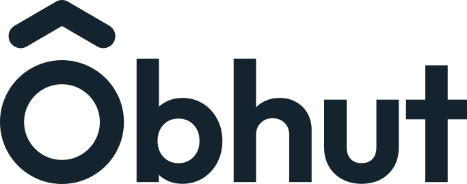
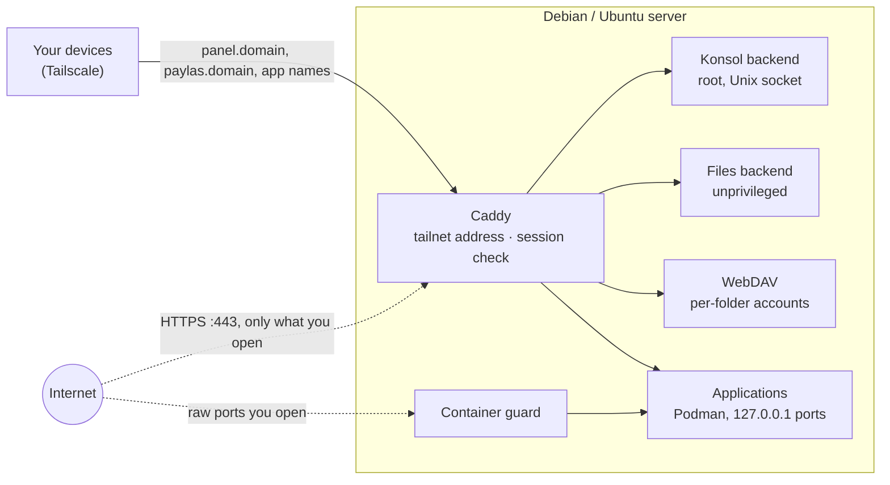

<p align="center"></p>

<p align="center"><strong>A private home server in one command, run from a web console on your tailnet.</strong></p>

<p align="center">
  
  
  
</p>

**Obhut** (German for *safekeeping*) turns a clean Debian or Ubuntu LTS server into a Tailscale exit
node with local names, a persistent firewall, file sharing, WireGuard and **Konsol**, a web console.
Any other software runs as a Podman container that you add from that software's own Docker Compose or
Kubernetes file. Everything is reachable from your own devices over Tailscale; nothing is published on
the internet unless you choose it, port by port. The console and the installer speak Turkish; the
documentation is in English.

## What Obhut is

Obhut is fixed infrastructure plus your applications.

- **Built-ins** come with every install and cannot be removed: Konsol, Tailscale (exit node), Caddy,
  dnsmasq, the firewall, Files (the server's folders, a trash and, on the tailnet, the whole server as
  root), folder WebDAV shares and WireGuard (installed turned off).
- **Applications** are only Podman containers. Obhut knows no application: there is no catalogue and no
  package. You bring the file the software publishes, in either of two formats (the *dual model*):

  ```
  Compose or Kubernetes file
    → reader → model → inspector ─┬→ refusals, with their lines
                                  └→ questions → your answers → Quadlet units → systemd → Podman
  ```

  Obhut's own YAML reader reads the file, the inspector (*denetçi*) refuses what is unsafe (privileged
  mode, host namespaces, devices, `build`, …) and asks what only you can answer: the application's name,
  how each port is reached, every variable and secret, where each folder lives, and whether each container
  starts as its own user or as root. Obhut then writes its own Quadlet units; systemd starts them and
  Podman runs them. There is no Docker, no Compose runtime and no Kubernetes. Images are pinned by digest
  and updated only when you confirm.
- **A port reaches outside only through Erişim.** Each container port is either an *address* (a Caddy
  row: a Tailscale name, optionally a Tailscale port and an internet name with HTTPS) or a *raw port*
  (closed, Tailscale or internet). The ports written in the file are never used.

Generation 2 (this tree) installs only on a clean operating system; a server that ran an older Obhut
must be reinstalled from scratch.

## Features

- **One-line install and safe re-runs.** A staged Bash installer, from packages to a final
  verification; running it again is safe. Konsol offers new builds of the same generation from this
  repository and installs them on confirmation.
- **Private by default.** Konsol and every local name (`panel.<domain>`, `paylas.<domain>`, your
  applications' names) are served by Caddy and dnsmasq on the Tailscale address only, behind a firewall
  that admits listed services alone.
- **Applications from their own files.** Paste or upload a Compose or Kubernetes file, give an `https`
  address, an image name or an existing container; review the inspector's questions and the plan; Obhut
  installs, starts, health-checks and rolls back on failure. Each application gets its own network, a
  visible data folder and a page with its state, access, storage, definition and log.
- **Files and sharing.** Storage at a glance (with each application's data), the server folders with a
  trash and a text editor, and per-folder WebDAV accounts with separate Tailscale and internet switches,
  read-only or read-write access and expiry.
- **WireGuard built in.** Up to ten networks with devices, QR codes and profiles; WireGuard devices reach
  only the internet, never the server's services.
- **Optional public names.** Konsol, WebDAV or an application's address can get an HTTPS name with a
  Let's Encrypt certificate on port 443, each only when you switch it on.
- **Changes you can take back.** A change that opens or widens access must be confirmed from Tailscale
  within 60 seconds (a domain change within five minutes), or the server rolls it back on its own;
  closing commits at once. "Denetle ve onar" checks and repairs 21 areas.

## How it works



Caddy serves Konsol, WebDAV and the applications' addresses. It checks the session for every Konsol
request and passes it to a root backend that listens on a Unix socket, never on a TCP port. Files and
WebDAV run as an unprivileged account on loopback; an application's address points at a `127.0.0.1`
port, and a raw port is published only on the Tailscale or internet address you chose, through the
container guard. Containers reach only the internet. dnsmasq answers the local names for your tailnet;
the firewall admits SSH, Tailscale, WireGuard and what you open, nothing else.

## Requirements

- A clean **Debian 13**, **Ubuntu 24.04 LTS** or **Ubuntu 26.04 LTS** server, root access and an SSH
  terminal (the installer asks one question and one confirmation).
- A **Tailscale** account: the installer prints a login link to approve the server.
- Optional: a domain whose A record points to the server, for public HTTPS names.

Ubuntu 24.04 ships Podman 4.9: on it, a Kubernetes Pod with more than one container and a Compose
`depends_on` with `condition: service_healthy` are refused before anything is written (both need
Podman 5). Generation 2 is live-verified on Debian 13 (Podman 5.4).

## Install

```bash
curl -fsSL https://raw.githubusercontent.com/drs0me1/obhut/main/kur.sh | sudo bash
```

1. `kur.sh` downloads this repository (`main`, or `KUR_REF=<commit|tag|branch>`; `KUR_URL` takes an
   archive of a tree that is not on GitHub yet), places the runtime files in
   `/root/debian-server-installer` and starts the installer on your terminal.
2. A first install asks for a local domain (e.g. `ev` gives `panel.ev`), shows a summary and waits
   for `E`; approve the Tailscale login link it prints.
3. In the Tailscale admin console, add the server's Tailscale IP as a nameserver restricted to your
   domain and approve it as an exit node (the summary lists the steps).
4. Open `http://panel.<domain>` from any device on your tailnet.

**Update:** Konsol → Sistem → Güncellemeler shows *Güncelle* when `main` carries a newer build of the
same generation; `sudo obhut guncelle` and running the install line again work too. **Repair:** Konsol →
Sistem → Sağlık, `sudo obhut onar` on the server, or `onar.command` from a Mac when Konsol cannot be
reached; `sudo obhut durum` shows the server's state over SSH. Konsol can be installed as an app from the
browser.

## Konsol at a glance

| Section | What you do there |
|---|---|
| **Genel Bakış** (Overview) | The applications, each with its state and address (*Aç*, *Ayrıntı*). What needs attention is on *Uyarılar*, which the count in the top bar opens, each with the way to its fix; the resources and the server are cards at the sidebar's foot |
| **Uygulamalar** (Applications) | Every application in one list; *Uygulama ekle* (a file, an `https` address, an image name, an existing container → the inspector → the plan); each application's page: Özet, Erişim, Depolama, Tanım (the file and the answers, edited as a plan), Günlük |
| **Podman** | Every container with its state, CPU, memory and ports; what each kind takes on disk; images, volumes, networks and removed applications' folders, where what nothing uses is ticked and removed |
| **Erişim** (Access) | Who reaches what from where; Adresler (addresses and raw ports, *Adres aç*), Yerel adlar (local names and the domain), WireGuard (networks and devices), Güvenlik duvarı (your rules) |
| **Dosyalar** (Files) | Depolama, the server folders, the trash, **Paylaşımlar** (one WebDAV account per folder, Tailscale and internet access, read-only/read-write, expiry) and, on the tailnet, the whole server as root |
| **Sistem** (System) | Health and repair (with its log), updates, the Konsol account, the server (with its Tailscale device) and reboot, the history of operations |
| **Gelişmiş** (Advanced) | Read-only: effective Caddy and DNS configuration, the technical firewall rules and listeners |

The command palette (Ctrl+K or Cmd+K) finds sections, tabs, applications and access rows. Konsol asks for
no sign-in on the tailnet; a public Konsol name requires the account you create in Sistem → Hesap over
Tailscale.

## Repository structure

| Path | Role |
|---|---|
| `kur.sh` | Server bootstrap: downloads a version, places the runtime files, starts the installer |
| `wireguard.command`, `onar.command` | Mac helpers over SSH: the WireGuard device menu; check and repair |
| `Data/install.sh`, `Data/common.sh` | The installer (packages, Tailscale, firewall, Caddy and dnsmasq, Konsol, the built-ins, verification) and its helpers |
| `Data/config/defaults.env` | Ports, paths and chain names, defined once |
| `Data/templates/`, `Data/systemd/` | Caddy and dnsmasq templates; units, timers and drop-ins |
| `Data/scripts/` | Server tools: firewall, WireGuard (`master-wg`), repair, update, Konsol account, `obhut` |
| `Data/panel/` | Konsol's root backend (Python standard library) and its modules: the application engine (YAML, Compose and Kubernetes readers, inspector, generator, records, worker), access rows and settings, shares and WebDAV, WireGuard, health |
| `Data/files-panel/` | The unprivileged file backend (and its root mode for the system view) |
| `Data/console/` | The sign-in page, the editor bundle and the marks; `console/yeni/` holds Konsol's committed build |
| `Data/tools/` | Build sources, not shipped: the text editor bundle and Konsol's interface (Vue 3 + TypeScript) |
| `Data/tests/` | Bats, Python, browser and isolated Linux suites |
| `Data/docs/` | Behaviour contract, architecture, design decisions, the API description |

## Security model

- **The tailnet is the management path.** Tailscale authenticates devices, so Konsol asks for no
  sign-in there. A public Konsol name requires the account created over Tailscale.
- **Opening is explicit, per port.** An application's ports are closed until you answer them; an
  internet name goes through Caddy with HTTPS, a raw internet port needs an extra consent. An
  application's internet name is protected only by the application's own login.
- **Contained applications.** No privileged mode, devices or host namespaces; folders only from `/srv`
  and the application's own folder; secrets kept as Podman secrets, never shown again; containers reach
  the internet only, not the server, the tailnet or private networks.
- **Strict web gates:** a Content Security Policy without inline code or external loads, a same-origin
  header on every API call, Host checks and no-store replies; the backend answers only the routes in its
  table.
- **Reversible network changes:** an independent server-side timer rolls back any opening that is not
  confirmed. Irreversible actions need a typed confirmation; Konsol and WebDAV passwords are kept as
  scrypt hashes.

## Documentation

| Document | Contents |
|---|---|
| [Behaviour contract](Data/docs/contract.md) | What the installer and Obhut do and refuse (authoritative) |
| [Architecture](Data/docs/architecture.md) | Layout, components and data flow |
| [Design decisions](Data/docs/design-decisions.md) | Why each non-obvious choice was made (`DD-*`, [index](Data/docs/decisions-index.md)) |
| [The rebuild](Data/docs/rebuild.md) | How generation 2 was built: its decisions and phases |
| [Konsol's API](Data/docs/konsol-api.json) | OpenAPI description generated from the backend's route table |
| [Folder shares](Data/docs/folder-shares.md) | WebDAV limits and what to tell recipients |
| [OKUBENI.txt](Data/OKUBENI.txt) | Step-by-step usage notes in Turkish |
| [Tests](Data/tests/README.md) | How to run each suite and what it covers |
| [Changelog](Data/CHANGELOG.md) | Changes per release and build |

## Development

```bash
cd Data
bats tests
shellcheck -x -s bash ../kur.sh install.sh common.sh scripts/*
python3.13 -m unittest discover -s tests -p 'test_*.py'
```

Releases follow semantic versioning and are tagged `vX.Y.Z` (`OBHUT_SURUM` in `Data/install.sh`);
every behavioural change also raises the build number (`V2_VERSION`) that servers compare when
Konsol offers an update. Browser, Linux and live suites are described in
[`Data/tests/README.md`](Data/tests/README.md). Konsol's interface is rebuilt with
`npm ci && npm run derle` in `Data/tools/konsol-ui`; a test checks that the committed build matches
its sources. `kur.sh` installs whatever `main` holds, so `main` stays installable after every push.
Working rules for contributors and assistants: [`CLAUDE.md`](CLAUDE.md).
